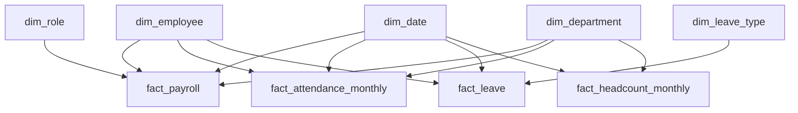

# PulseIQ Analytics Warehouse — Star Schema

## 1. Business Questions
- What is the payroll cost by department and month?
- How does employee headcount change each month?
- What is the monthly attendance rate?
- How many leave days are taken by leave type?
- How many employees leave the company over time?

## 2. Dimension Tables
- dim_employee
- dim_department
- dim_role
- dim_date
- dim_leave_type

## 3. Fact Tables and Grain
- fact_payroll: one row per employee per payroll month.
- fact_attendance_monthly: one row per employee per attendance month.
- fact_leave: one row per leave record.
- fact_headcount_monthly: one row per reporting month and department.

## 4. Employee History — SCD Type 2
The dim_employee table preserves historical employee versions.

- valid_from: date the version becomes effective.
- valid_to: date the version ends.
- is_current: indicates the current version.

When an employee changes department, keep the old version and insert a new version. Historical reports use the version effective during the reporting period.

## 5. Validation
Confirm exact table columns, keys, and fact grains against the supplied Excel workbook before creating the PostgreSQL tables.

## 6. Star Schema Diagram

> Note: This is a conceptual star-schema diagram. Confirmed database foreign keys may cover only some of these relationships.

## 7. Source Data Grain Limitation

The supplied attendance dataset contains monthly summary records, not
daily employee attendance records. The current warehouse therefore uses
`fact_attendance_monthly`, with one row per employee per attendance month.
A daily-grain attendance fact table cannot be produced accurately from
this source alone. Daily-level source data is required to satisfy a
daily attendance grain requirement without inventing records.

## 8. Employee History Rule — SCD Type 2

If an employee moves from Sales to Support in July:

- June payroll belongs to Sales.
- July payroll belongs to Support.
- Join payroll to dim_employee using employee_key, not only employee_id.
- Use the employee version effective during the payroll period.

This preserves accurate historical payroll reporting when employees change departments.

