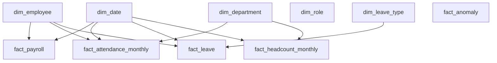

# PulseIQ Warehouse Star Schema

## Dimension Tables

- `dim_date` — Date and month details
- `dim_employee` — Employee details and SCD Type 2 history
- `dim_department` — Department details
- `dim_role` — Job role details
- `dim_leave_type` — Leave category details

## Fact Tables

- `fact_payroll` — Payroll transaction details
- `fact_attendance_monthly` — Monthly attendance summaries
- `fact_leave` — Leave records
- `fact_headcount_monthly` — Monthly department headcount
- `fact_anomaly` — Flagged anomaly results

## Schema Diagram

**Note:** The diagram shows the intended analytical relationships. `fact_anomaly` is included in the warehouse, but its employee relationship should be documented separately if needed.
